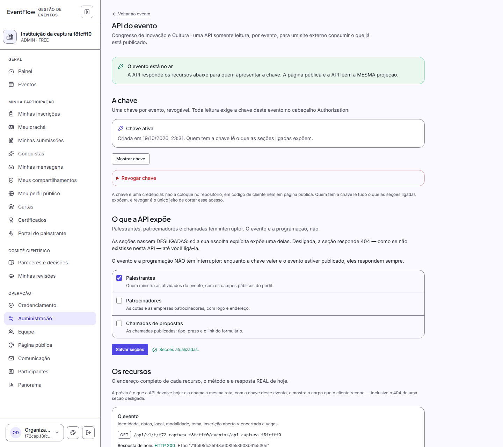
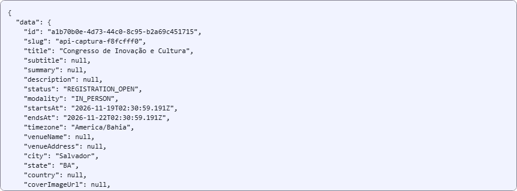

# FASE 72 — A API de leitura do evento

> **Entrega:** Outubro de 2026
> **Status:** Concluída · Código, testes e documentação entregues
> **Testes:** 3773 (Vitest: unitários e integração, 204 arquivos) + 393 (Playwright E2E; 390 passando + 3 vermelhos PRÉ-EXISTENTES diagnosticados na §6.9) + 1 skip
> **ADRs:** ADR-354 a ADR-356 (356 ADRs acumuladas no projeto)

---

## 1. Sumário Executivo

A **FASE 72** entregou uma **API por evento, somente leitura**, para que um site externo
consuma o que já está cadastrado e publicado — sem abrir um segundo caminho para o banco e
sem transformar a página pública em duas verdades.

Ela nasceu de uma decisão de produto explícita: **uma chave por evento, revogável**, e não
uma chave por instituição. A consequência foi absorvida pelo desenho: **toda leitura exige a
chave daquele evento**; a lista de eventos da instituição **saiu do `v1`**, porque uma lista
entre eventos exigiria uma credencial que não foi aprovada. Uma chave, um evento, um
consumidor identificado.

### O que foi entregue

| # | Entrega | Onde |
|---|---|---|
| 1 | **Projeção única** — `getPublicEventView` extraída da página; a API lê a MESMA visão, com `generatedAt` injetado | `src/lib/events/public-event-view.ts`, `src/lib/api/event-api-service.ts` |
| 2 | **Contrato fechado** — envelope `{ data, meta }`, ordem canônica de cada recurso e lista fechada do que NUNCA sai | `src/domain/api/public-api-contract.ts` |
| 3 | **Chave por evento** — selada com AES-256-GCM (cofre único extraído da F48), índice SHA-256, criação/revogação/reexibição e trilha | `src/domain/api/event-api-key-rules.ts`, `src/lib/api/event-api-key-service.ts`, `src/lib/crypto/sealed-secret-vault.ts` |
| 4 | **Cinco rotas** — evento, atividades, palestrantes, patrocinadores e chamadas | `src/app/api/v1/t/[tenantSlug]/eventos/[eventSlug]/**` |
| 5 | **HTTP de contrato** — ETag/304, `Vary: Authorization`, CORS, 401 uniforme, 404 uniforme, 405, 429 com `Retry-After` | `src/lib/api/event-api-http.ts`, `src/lib/api/event-api-route-handlers.ts` |
| 6 | **A tela do organizador** — `/administracao/eventos/<id>/api`, cartão na raiz, selo de estado, prévia pela rota real e interruptores | `src/app/t/[tenantSlug]/(app)/administracao/eventos/[eventId]/api/page.tsx` |
| 7 | **Correção fora de escopo** — quatro cartões da raiz não declaravam a permissão que a tela exige | `src/domain/events/event-areas.ts` |
| 8 | **Catraca nova** — lê o par (área → página) e reprova quando o cartão e a guarda divergem | `tests/unit/f72-cartao-esconde-o-que-a-tela-recusa.test.ts` |
| 9 | **Correção do upload no MinIO novo** — o checksum agora vai no cabeçalho ASSINADO | `src/lib/storage/s3-client.ts` |
| 10 | **Documentação e estado** — este documento, ADR-354…356, README, AGENTS e dívidas | `docs/`, `README.md`, `AGENTS.md` |





### Números da fase

| Métrica | Antes (F71) | Depois (F72) | Variação |
|---|---|---|---|
| **Testes Vitest (unit + integração)** | 3656 | **3773** | **+117** (116 nos oito arquivos `f72-*` + 1 caso novo no `f54-selo-de-contagem`) |
| **Testes Playwright E2E** | 388 | **393** | **+5** (4 do spec `f72` + 1 caso da tela da API no portão WCAG) |
| **ADRs registradas** | 353 | **356** | +3 (ADR-354 a ADR-356) |
| **Permissões** | 66 | 66 | 0 |
| **Tabelas de tenant sob RLS** | 60 | 60 | 0 |
| **Migrações** | — | **0** | a chave vive em `Event.settings.api` |
| **Rotas de API `/v1`** | 0 | **5** | evento, atividades, palestrantes, patrocinadores, chamadas |
| **Arquivos novos / alterados** | — | **31 novos + 9 alterados** | ver §1.1 |

### 1.1 Arquivos da fase

**Novos (31):** 3 de domínio (`public-api-contract`, `event-api-key-rules`,
`event-api-organizer-rules`), 8 em `src/lib/api`, o cofre genérico em `src/lib/crypto`,
`public-event-view`, 5 arquivos de rota, a página da tela, 2 componentes de administração,
1 arquivo de Server Actions e 9 de teste (6 unitários, 2 de integração, 1 E2E).

**Alterados (9):** `src/domain/events/event-areas.ts` (TAREFA 1), `event-repository.ts`
(instante injetável no detalhe público), a página pública do evento (passou a ler a visão
única), a raiz do evento (selo/estado da API), `event-area-counts.ts` (contagem do estado da
chave), `card-share-token.ts` (delega ao cofre único), `s3-client.ts` (checksum assinado),
`tests/unit/f54-selo-de-contagem.test.ts` (o selo da área `api`) e
`tests/e2e/accessibility.spec.ts` (a tela da API no portão WCAG).

---

## 2. O Problema Mais Difícil da Fase

**A API não pode montar a própria consulta — mas a prévia do organizador precisa mostrar a
resposta real, inclusive quando ela é um 404.**

O sistema já tinha uma fronteira testada entre o que o público vê e o que é do organizador: a
projeção pública da página, com a ocultação da F60, o endereço da sala online resolvido no
servidor (F68/F71), as respostas do formulário e o CPF fora (F70) e os rascunhos fora. Uma API
que escrevesse `withTenant(...)` e `tx.event.findMany(...)` seria um **segundo caminho para o
banco**, e o primeiro defeito dela seria o vazamento que a página evita.

O caminho escolhido foi uma função de projeção, dois consumidores: a página passa o `userId`
da sessão; a API passa `null` (não há sessão em uma API pública por chave). O que muda entre
as duas é o FATO de quem olha, nunca a consulta nem a régua de visibilidade. A página passou a
chamar `getPublicEventView` também nos metadados — dois caminhos de leitura na mesma página
seriam a mesma divergência em escala menor.

A parte difícil não é extrair a função; é **prender o caminho contra o futuro**. Um teste de
snapshot de HTML prenderia o desenho de hoje e passaria com uma segunda consulta: bastaria o
HTML continuar igual. A catraca da fase é de **importação e de ausência de consulta** — ela lê
o texto-fonte da página e do serviço da API, exige `getPublicEventView` nos dois, proíbe
`getPublicEvent` nos dois e reprova `withTenant`, `adminPrisma`, `findFirst/findMany/findUnique/count`
e `$queryRaw` em qualquer um. A projeção por recurso também é pura: sem Prisma, sem `new Date()`,
sem `Date.now()`, sem `randomUUID()`.

O segundo lado do mesmo problema é a **prévia**. Escrever um "exemplo bonito" na tela — ou
chamar `loadEventApiProjections` direto — criaria um terceiro caminho: a prévia poderia mostrar
um JSON enquanto a rota responde 404 por causa de uma seção desligada. A prévia chama o MESMO
`createEventApiRouteHandlers` que as cinco rotas montam, com a chave do próprio evento no
`Authorization`. A única injeção é o limitador — e a razão está medida pelo desenho: a tela
renderiza **cinco respostas** por abertura, e o teto real de 120/min derrubaria a própria prévia
com 429 depois de **24 aberturas** na mesma janela. A consequência aceita é que a prévia mostra
o 404 real de uma seção desligada e o 404 real de um rascunho.

---

## 3. Decisões Técnicas Explicadas

### 3.1 Uma projeção, dois consumidores — e o instante também é único

`getPublicEventView` faz a sequência que antes vivia solta na página:
`getPublicEvent` → `resolveOnlineRoomViewer` → `applyOnlineRoomVisibility`. A API a chama com
`userId: null`, e o endereço da sala chega `null` à projeção antes de qualquer mapper. O
`generatedAt` da resposta também é injetado: `getPublicEvent` ganhou `options.now` para que o
`status` derivado (ex.: `REGISTRATION_OPEN`) e o `meta.generatedAt` sejam o MESMO instante. Se
cada um usasse o próprio relógio, uma resposta poderia anunciar inscrição aberta e um instante
já depois do fechamento.

### 3.2 A chave mora em `Event.settings.api`, sem migração

É configuração POR EVENTO, do mesmo tipo que a política de inscrição e o formulário da F70: um
objeto pequeno, lido por inteiro e sem consulta por campo. Criar uma tabela só para ele exigiria
migração, policy de RLS e um serviço de leitura para guardar três datas e três booleanos. A
leitura é sempre pelo SLUG do evento; o SHA-256 é índice de COMPARAÇÃO, não caminho de busca.

O leitor é tolerante e **fail-closed**: uma configuração torta não derruba a rota com 500 nem é
aceita "mais ou menos" — devolve `configured: false` e o motivo, que vira 401 na rota e log na
trilha. Configuração inválida **não vira selo** na tela.

### 3.3 A chave é SELADA, não é hash puro nem texto claro

O organizador precisa **reexibir** a chave quando quiser; hash puro obrigaria a "gerar outra e
revogar", invalidando o site que ele acabou de integrar. Texto claro faria qualquer leitura do
banco (relatório, suporte, despejo) virar uma lista de credenciais prontas. O selo AES-256-GCM
resolve os dois: a aplicação abre quando o organizador pede, o banco sozinho não abre. O índice
público é SHA-256, usado na verificação em tempo constante.

A chave derivada usa um **rótulo próprio** (`eventflow:event-api-key:`) sobre o
`BETTER_AUTH_SECRET`: o mesmo segredo produz chaves diferentes para domínios diferentes. Girar
o segredo derruba só o REEXIBIR — a comparação por hash continua valendo e a mensagem da tela
diz isso, em vez de fingir.

### 3.4 O cofre deixou de ser dois

O AES-GCM da F48 (link da carta) foi extraído para `src/lib/crypto/sealed-secret-vault.ts`.
A implementação é UMA: IV de 12 bytes, tag, derivação por rótulo e `open` que devolve `null`
para selo corrompido ou de outra chave. `card-share-token.ts` passou a delegar a ele com o
MESMO rótulo (`eventflow:card-share:`), então os links já emitidos continuam abrindo. A prova
medida: `tests/integration/card-share.test.ts` **14/14** (e a família de cartas, 51/51).

A alternativa — copiar o arquivo e trocar o rótulo — foi descartada por um motivo concreto:
duas implementações de criptografia divergem no primeiro ajuste, e a que ficou para trás só é
descoberta no dia em que o segredo vaza.

### 3.5 401 uniforme, e 404 só depois da autenticação

Com chave por evento, um `404` para slug inexistente distinguiria "existe" de "não existe" e
reabriria o oráculo que o `404` de rascunho fecha. A ordem das portas é:

1. `OPTIONS` sai antes de tudo (preflight não consome taxa nem chave);
2. método diferente de GET/HEAD → `405` com `Allow`;
3. limite de taxa por IP, antes de qualquer banco;
4. instituição + chave: inexistente, sem chave, chave errada, revogada e evento inexistente
   respondem o MESMO `401` (`MISSING_API_KEY` ou `INVALID_API_KEY`, conforme o que a
   requisição trouxe);
5. seção desligada → `404` — só chega aqui quem tem a chave válida;
6. projeção única e envelope.

Rascunho e evento inexistente **não** respondem igual: o rascunho, com chave válida, recebe o
mesmo `404` da seção desligada — os dois são "não existe nesta API". O inexistente sem chave
recebe `401`, porque qualquer requisição a um evento que não tem chave é uma requisição sem
chave válida.

### 3.6 As seções nascem DESLIGADAS

Só `true` explícito expõe `palestrantes`, `patrocinadores` e `chamadas`: ausente, `false`,
`"true"` e `1` desligam. "Expor é decisão explícita" foi a decisão 3 do humano, e o padrão
silencioso teria exposto as três no instante em que a chave fosse criada, com três
interruptores que ninguém tocou. Evento e atividades **não** são interruptáveis: respondem
sempre que a chave vale e o evento está publicado.

### 3.7 O HTTP é contrato: ETag sem `generatedAt`, cache variando por `Authorization`

O `ETag` é derivado do **conteúdo canônico do `data`**, nunca do envelope. `meta.generatedAt`
muda a cada requisição; se entrasse no hash, o `304` nunca aconteceria e o requisito de cache
viraria decoração. O `meta.etag` do corpo é o mesmo valor do cabeçalho.

`Cache-Control: public, max-age=60` é a decisão do humano. Como a leitura exige chave,
`Vary: Authorization` acompanha: sem ele, um cache COMPARTILHADO poderia servir o corpo chaveado
a uma requisição que não apresentou chave. `public` é a decisão; `Vary` impede que ela vire
bypass. Erros levam `no-store` (recusa não se guarda) e **CORS `*` em todas as respostas**,
inclusive 401/429 — o site do cliente precisa LER o motivo.

### 3.8 O limite é 120/min por IP — mitigação, não autorização

O consumidor é um site externo lendo conteúdo que muda devagar; 2 req/s cobrem a montagem de
várias páginas e um cache local de 60 s. O teto existe para (a) impedir que uma origem
transforme sondagem de chave em carga de banco e (b) limitar a enxurrada de linhas de trilha
que cada recusa grava. Sem Redis, o limitador da F13 **falha aberto** e registra a métrica: a
proteção é mitigação, não autorização — quem autoriza é a chave.

### 3.9 A tela é cliente da própria API e funciona sem JavaScript

Gerar, mostrar, revogar e ligar/desligar seção são `<form>` POST de verdade, com
`useActionState`; não há estado de cliente decidindo o que a tela diz. O E2E roda a jornada
inteira com `javaScriptEnabled: false`. A revogação usa `<details>` nativo (o `ConfirmDialog`
da casa é um portão de JavaScript): perde-se o modal, não se perde o portão.

O cartão da raiz declarava a permissão errada em quatro áreas; a correção e a catraca estão na
§5 e na §8. A tela da API exige `event:update` — a chave é CONFIGURAÇÃO do evento, não uma
operação que afeta pessoas (que é o que `event:manage` cobre).

---

## 4. Registro de Decisões de Arquitetura (ADRs)

### ADR-354 — A API lê a projeção da página; a catraca prende a importação, não o HTML

- **Contexto:** a página pública do evento montava a própria sequência de leitura
  (`getPublicEvent` → `resolveOnlineRoomViewer` → `applyOnlineRoomVisibility`). A API por
  evento precisava dos mesmos dados e da mesma régua de visibilidade. Escrever uma segunda
  sequência criaria um segundo caminho para o banco; prender a igualdade por snapshot de HTML
  prenderia o desenho de hoje e passaria com uma consulta nova.
- **Decisão:** extrair `getPublicEventView` como a sequência ÚNICA (ler, resolver quem vê a
  sala, aplicar) e consumi-la pela página e pela API. A projeção por recurso é uma allowlist
  escrita à mão, pura (sem Prisma, relógio ou gerador de id), e o envelope reprova a projeção
  inteira se um campo da lista fechada aparecer. A catraca lê o texto-fonte dos dois
  consumidores e exige a mesma importação, proibindo consulta própria.
- **Justificativa:** o defeito que a fase quer tornar impossível não é "um campo com valor
  diferente": é um SEGUNDO CAMINHO. Enquanto a fonte for uma só, os valores não podem divergir
  por construção; no dia em que alguém escrever `withTenant`/`findFirst` no serviço da API, a
  catraca reprova antes de qualquer teste de valor perceber. A lista fechada é a segunda
  barreira, e o teste de integração mede o dado real (inclusive com `onlineUrl` preenchido de
  propósito).
- **Consequências:** campo novo na API exige passar pela projeção — nunca por uma consulta
  própria. Os metadados da página também usam a visão única. O `now` é injetado para que
  status derivado e `generatedAt` sejam o mesmo instante. A API não devolve a lista de eventos
  da instituição no `v1` (decisão 2 do humano).

### ADR-355 — A chave é do evento, selada no cofre único, com 401 uniforme e seções que nascem desligadas

- **Contexto:** a decisão do humano foi **chave por evento, revogável**, com CORS aberto e
  interruptor por seção. A chave precisa ser reexibível pelo organizador (o site externo já a
  copiou), mas o banco sozinho não pode abri-la. O `404` de evento inexistente, com chave por
  evento, distinguiria "existe" de "não existe".
- **Decisão:** guardar `{ chaveSelada, chaveHash, criadaEm, revogadaEm?, secoes }` em
  `Event.settings.api`, selando com AES-256-GCM e indexando por SHA-256. A chave só é gravada
  quando o selo é possível (`SEAL_UNAVAILABLE` em vez de claro). O cofre é o módulo genérico
  extraído da F48, com rótulo próprio. Toda leitura exige `Authorization: Bearer`; ausente,
  errada, revogada e evento inexistente respondem o mesmo `401`. Uma seção só expõe com `true`
  explícito; desligada responde `404` como se não existisse naquela API.
- **Justificativa:** hash puro obrigaria a rotacionar para reexibir e invalidaria o site
  integrado; claro exporia credenciais em qualquer leitura do banco. O `401` uniforme mantém o
  oráculo fechado; o padrão desligado impede expor sem gesto. O `Vary: Authorization` impede
  que o cache público (`public, max-age=60`) sirva o corpo chaveado a quem não apresentou
  chave.
- **Consequências:** a chave aparece uma vez e pode ser reexibida; girar o segredo derruba só
  o reexibir; criar com outra ativa responde `ALREADY_EXISTS` (rotacionar é revogar e criar,
  dois atos e dois registros). Criar, revogar e cada recusa vão para `audit_logs`; a chave em
  claro nunca entra na trilha nem em log. As seções nascem desligadas, e a tela diz qual está
  desligada.

### ADR-356 — A resposta é conteúdo e a tela é cliente da API: ETag sem `generatedAt`, prévia pela rota real e cartão que declara a permissão da tela

- **Contexto:** a resposta de leitura precisa de cache (`ETag`/`304`) e a tela do organizador
  precisa mostrar "o que o cliente recebe hoje", inclusive 404. A tela também precisa funcionar
  sem JavaScript, e a raiz do evento já escondia cartões pela permissão declarada no catálogo —
  quatro cartões não declaravam nada e apareciam para quem a página recusava.
- **Decisão:** calcular o `ETag` sobre o `data` canônico (nunca sobre o envelope), responder
  `304` sem corpo e manter `Cache-Control: public, max-age=60` + `Vary: Authorization`. A
  prévia chama o MESMO handler das rotas com a chave do evento; a única injeção é o limitador,
  porque a tela renderiza cinco respostas por abertura. Toda a tela é `<form>` POST (gerar,
  mostrar, revogar, seções), com `<details>` nativo na revogação. O catálogo de áreas declara a
  permissão que a página exige, e uma catraca resolve o `href` até o `page.tsx`, lê o
  `requirePagePermission` e compara — nos dois sentidos.
- **Justificativa:** incluir `meta.generatedAt` no hash mataria o `304` para sempre. Um exemplo
  de JSON escrito à mão mentiria no dia em que o interruptor mudasse. O limitador real na
  prévia derrubaria a própria tela com `429` depois de 24 aberturas (5 × 24 = 120) e o `429` não
  diria nada sobre o conteúdo. Um cartão sem permissão promete uma tela que recusa o clique —
  exatamente o defeito que a fase encontrou.
- **Consequências:** a prévia mostra o 404 real de seção desligada e de rascunho; o custo é 5
  chamadas de handler por render (declarado como dívida, §8). O cartão declara a mesma
  permissão da página; a raiz a avalia no escopo TENANT, então quem só tem o papel por EVENTO
  em credenciamento não vê o cartão embora consiga abrir a URL (ponto de atenção, §8). A
  revogação é imediata: a requisição seguinte recebe `401`.

---

## 5. Lições Aprendidas

### 5.1 As nove lições, com a evidência de cada uma

| # | Lição (medida) | O que foi medido | Onde está preso |
|---|---|---|---|
| 1 | **A API não faz consulta própria** | Página e serviço importam `getPublicEventView`; nenhum dos dois chama `getPublicEvent`, `withTenant`, `adminPrisma`, `find*`, `count` ou `$queryRaw`; a projeção é pura (sem relógio/id) | `f72-catraca-divergencia.test.ts` (7 testes) e `f72-api-projecao.test.ts` (8, com banco) |
| 2 | **`Vary: Authorization`** | 200 e 304 saem com `Cache-Control: public, max-age=60` **e** `Vary: Authorization`; erros saem `no-store` | `f72-http-da-api.test.ts` e `f72-endpoints-da-api.test.ts` (asserts de `vary`) |
| 3 | **O ETag exclui `meta.generatedAt`** | O mesmo `data` com `generatedAt` 60 s depois responde `304` sem corpo; o `meta.etag` do corpo é o do cabeçalho | `f72-http-da-api.test.ts` (7 casos de ETag/304) |
| 4 | **O cofre deixou de ser dois** | O link da carta delega ao módulo genérico com o mesmo rótulo; selos antigos continuam abrindo; a família de cartas passa 51/51, e `card-share.test.ts` **14/14** | `src/lib/crypto/sealed-secret-vault.ts`, `card-share-token.ts`, `card-share.test.ts` |
| 5 | **401 uniforme, não 404 de inexistente** | Evento inexistente e chave errada devolvem o MESMO corpo de 401; rascunho e seção desligada devolvem o MESMO corpo de 404 | `f72-endpoints-da-api.test.ts` (5 rotas, 32 testes) |
| 6 | **Seções nascem DESLIGADAS** | `true` explícito liga; ausente, `false`, `"true"` e `1` desligam; o E2E vê `/palestrantes` 404 antes e 200 depois do interruptor | `f72-chave-da-api.test.ts` (12), `f72-tela-do-organizador.test.ts` (24) e E2E caso 2 |
| 7 | **A prévia é a rota real** | A prévia usa `createEventApiRouteHandlers` com a chave do evento; a única injeção é o limitador; o E2E vê o 404 real da seção desligada e do rascunho | `event-api-organizer-preview.ts`, E2E casos 2 e 4, `f72-tela-do-organizador.test.ts` |
| 8 | **O cartão escondia o que a tela recusava** | Quatro cartões sem `permission` (chamadas, confirmações, sorteios, credenciamento); a catraca nova reprova o cartão que não declara a guarda da página | TAREFA 1, `f72-cartao-esconde-o-que-a-tela-recusa.test.ts` (4), mutação provada |
| 9 | **A tela funciona sem JavaScript** | Gerar, mostrar, ligar seção e revogar são POST de verdade; o E2E roda com `javaScriptEnabled: false` e passa os 4 casos | `tests/e2e/f72-api-do-organizador.spec.ts` (4/4) |

### 5.2 Defeitos REAIS encontrados por testes

| Sintoma | Causa raiz | Correção aplicada |
|---|---|---|
| **Quatro cartões da raiz do evento apareciam para quem a tela por trás redirecionava.** O caso concreto que abriu a TAREFA 1: um CHAIR (ou qualquer pessoa com a permissão da raiz e sem a da página) via "Chamadas de trabalhos", clicava e caía no painel. O mesmo valia para "Confirmações de vaga", "Sorteios" e "Credenciamento". | `EVENT_AREAS` tinha `permission` opcional e **quatro áreas não a declaravam**, enquanto as páginas exigiam `EVENT_MANAGE` (chamadas, sorteios), `REGISTRATION_UPDATE_ANY` (confirmações) e `ATTENDANCE_MANAGE` (credenciamento). Não havia catraca ligando o catálogo à guarda real de cada `page.tsx`. | As quatro áreas passaram a declarar a permissão exata da tela (`src/domain/events/event-areas.ts`). A catraca nova resolve o `href` da área, encontra o `page.tsx` pela rota, lê o `requirePagePermission` e compara nos dois sentidos. **Mutação provada:** removida a permissão de `chamadas`, o teste reprovou com `exigidaPelaTela: "event:manage"` / `declaradaNoCartao: null`; restaurada, os 3 casos voltaram a passar. |
| **O upload de imagem respondia `HTTP 400` e o MinIO registrava `request carries unsigned header X-Amz-Checksum-Sha256`.** O E2E `landing-page.spec.ts` (caso do logotipo, F41) falhava; a mesma causa derrubava **1 teste de integração** (`peer-review`, checksum do storage, E26) na suíte Vitest. | O MinIO foi reconstruído com `cgr.dev/chainguard/minio:latest` (release `2026-09-22T19-25-18Z`), que passou a exigir que **toda** `x-amz-*` presente na requisição esteja assinada. O SDK v3, ao assinar, "iça" `ChecksumSHA256` para a **query** e deixa de incluir o cabeçalho em `X-Amz-SignedHeaders`; o navegador continuava mandando `x-amz-checksum-sha256` em `requiredHeaders` — um cabeçalho não assinado. | `getSignedUrl` passou a receber `unhoistableHeaders: new Set(['x-amz-checksum-sha256'])` em `src/lib/storage/s3-client.ts`: o checksum fica como CABEÇALHO, volta para `X-Amz-SignedHeaders` e o MinIO aceita. Medição: a URL assinada passou a ter `X-Amz-SignedHeaders=content-length;content-type;host;x-amz-checksum-sha256`, o PUT respondeu 200 e `inspectObject` devolveu o SHA-256 calculado, igual ao declarado. O teste isolado do logotipo passou (5,4 s) e a integração do E26 voltou a passar. **Não foi máscara:** nenhum `skip`, nenhuma asserção relaxada. |

### 5.3 O que NÃO foi medido

- **Latência da prévia.** Sabe-se que o handler é chamado 5× por render (5 recursos) e que cada
  chamada lê instituição + chave + projeção; não se mediu o tempo de render com banco quente.
  O número não é inventado aqui.
- **Custo do limitador por IP em produção.** O teto de 120/min foi provado com o limitador
  injetado no teste de 429; não se mediu o comportamento sob carga real de um site externo.
- **Compatibilidade de outros clientes S3.** A correção do checksum foi medida contra o MinIO
  do compose; não se testou contra AWS S3 real.

---

## 6. Evidência de Verificação

> Todas as saídas abaixo são da árvore desta fase, medidas em **19/10/2026**, com o container
> reconstruído antes do E2E (`eventflow/web:local` de 23:11, `eventflow/worker:local` de 23:12).

### 6.1 `npm run lint`

```text
npm notice run eventflow@0.1.0 lint
npm notice run eslint .
# exit code 0 — 0 erros, 0 warnings
```

### 6.2 `npm run typecheck`

```text
npm notice run eventflow@0.1.0 typecheck
npm notice run tsc --noEmit
# exit code 0 — 0 erros
```

### 6.3 `npm test`

```text
 Test Files  204 passed (204)
      Tests  3773 passed (3773)
   Start at  23:26:51
   Duration  155.44s
# exit code 0
```

Contagens por arquivo da fase (medidas com `npx vitest run f72`): `f72-projecao-da-api` 17,
`f72-http-da-api` 12, `f72-chave-da-api` 12, `f72-catraca-divergencia` 7,
`f72-tela-do-organizador` 24, `f72-cartao-esconde-o-que-a-tela-recusa` 4,
`f72-api-projecao` (integração) 8, `f72-endpoints-da-api` (integração) 32 — **116**; mais 1
caso novo no `f54-selo-de-contagem` (10 no arquivo), total **117**.

### 6.4 `npm run build`

```text
✓ Compiled successfully in 32.4s
├ ƒ /api/v1/t/[tenantSlug]/eventos/[eventSlug]
├ ƒ /api/v1/t/[tenantSlug]/eventos/[eventSlug]/atividades
├ ƒ /api/v1/t/[tenantSlug]/eventos/[eventSlug]/chamadas
├ ƒ /api/v1/t/[tenantSlug]/eventos/[eventSlug]/palestrantes
├ ƒ /api/v1/t/[tenantSlug]/eventos/[eventSlug]/patrocinadores
# exit code 0
```

### 6.5 `npm run db:verify`

```text
  ✓  RLS habilitada + FORCE em todas as tabelas com tenantId
  ✓  Nenhuma tabela com RLS ficou sem policy
  ✓  Role "eventflow_app" sem superuser e sem BYPASSRLS
  ✓  GRANTs mínimos presentes, TRUNCATE ausente
  ✓  Tabela(s) de plataforma inalcançável(is) pela role "eventflow_app"

  Contrato íntegro.
```

### 6.6 `npm run db:verify:isolation`

```text
  ✓  [A1] … [A9]
  9/9 verificações passaram.
  Isolamento entre tenants garantido pelo banco.
```

### 6.7 `npm run db:partitions`

```text
  · todas as partições do intervalo já existiam
  audit_logs_2026_10              51724    28.88 MB
  audit_logs_2026_11                  0     0.04 MB
  audit_logs_2026_12                  0     0.04 MB
  total: 95596 linha(s)
```

### 6.8 E2E — o spec da fase

```text
Running 4 tests using 1 worker
  ✓  1 … o cartão está na raiz e, sem chave, a tela diz que a API responde 401
  ✓  2 … gerar, usar a chave contra a API real (200), ligar a seção (404 → 200) e revogar (401)
  ✓  3 … SEM JavaScript: gerar, mostrar, ligar a seção e revogar continuam funcionando
  ✓  4 … evento em rascunho: a tela avisa e a API responde 404 com a chave válida
  4 passed (8.7s)
```

### 6.9 E2E — a suíte inteira

```text
Running 394 tests using 1 worker
  3 failed
    [chromium] › tests\e2e\f62-regressao-visual.spec.ts:1969:3 › rodapé público da plataforma › 13. o rodapé público da raiz no claro
    [chromium] › tests\e2e\f62-regressao-visual.spec.ts:1982:3 › rodapé público da plataforma › 14. o rodapé público da raiz no escuro
    [chromium] › tests\e2e\f65-exportacao.spec.ts:717:3 › (e) a aba "Acontecendo agora" › a navegação é por link com aria-current, e a aba mostra o que está em curso
  1 skipped
  390 passed (9.7m)
# exit code 1 — 390 passando, 3 vermelhos PRÉ-EXISTENTES (abaixo), 1 skip
```

O caso do logotipo da F41, que era o vermelho esperado do MinIO, **passou** nesta mesma
execução depois da correção do checksum (e tem a prova isolada na §6.10).

#### 6.9.1 Os três vermelhos, medidos e diagnosticados (não são da F72)

1. **`f62` 13/14 — o rodapé público da raiz.** O snapshot é `fullPage` de `/`, e a raiz
   passou a ter conteúdo DINÂMICO: a lista "Próximos eventos com inscrições abertas" e as
   métricas agregadas. A linha de base versionada
   (`tests/e2e/f62-regressao-visual.spec.ts-snapshots/rodape-publico-claro-chromium-win32.png`)
   foi gravada com **dados de execuções de E2E** — ela mostra `Congresso F21b663c76`,
   `Congresso sem espaço b663c76` e métricas `44+ / 32+ / 19+ / 16+`, que não são o seed. O
   teste mede o DADO, não só o rodapé. A execução isolada **continua vermelha** (2 failed),
   o que prova que não é carga da suíte. É um defeito antigo da linha de base, não da F72.
   Depois da limpeza de 50 instituições residuais (`npm run e2e:clean -- --confirmar`), a
   raiz passou a mostrar o seed e as duas instituições de fixture; o snapshot antigo não
   corresponde a nenhum estado limpo. **Não foi atualizado**: atualizar a imagem seria
   mascará-lo, e o certo é mascarar as seções dinâmicas ou recortar o rodapé — decisão de
   outra fase.
2. **`f65` — a aba "Acontecendo agora".** A fixture cria a atividade em `beforeAll` com
   `startsAt = Date.now() - 20 min`; a asserção **recalcula** `new Date(Date.now() - 20 min)`
   no momento do teste. Se a virada do minuto acontece entre os dois, o rótulo esperado fica
   um minuto à frente do rótulo renderizado. Medição isolada: esperado `19/10/2026, 23:06`,
   recebido `19/10/2026, 23:05 – 20/10/2026, 00:05`. A execução isolada **também falha**
   (1 failed), pelo mesmo motivo. É um defeito do TESTE (o valor esperado devia ser o da
   fixture, não um novo `Date.now()`), não do produto nem da F72. **Não foi mascarado**:
   nenhum `skip`, nenhuma tolerância nova.
3. **A ausência do vermelho do MinIO.** O caso do logotipo e a integração do E26 passaram
   depois da correção; o vermelho que a fase esperava **deixou de existir** e está
   documentado na §6.10.

### 6.10 O vermelho do MinIO, medido isolado antes e depois

**Antes da correção** (`landing-page.spec.ts` → "a cota escolhe COR e TAMANHO da logo", com o
container antigo):

```text
  ✘  1 … a cota escolhe COR e TAMANHO da logo, e a página pública muda os dois (FASE 41)
    Expected pattern: /guardada em WebP/i
    Received string:  "O envio ao armazenamento falhou (HTTP 400)."
  1 failed
```

MinIO, no mesmo instante:

```text
Error: request carries unsigned header X-Amz-Checksum-Sha256;
Signature V4 requires every x-amz-* header to be signed
```

**Depois da correção** (mesmo caso, container reconstruído):

```text
  ✓  1 … a cota escolhe COR e TAMANHO da logo, e a página pública muda os dois (FASE 41) (5.4s)
  1 passed (8.0s)
```

A prova de que o checksum continua sendo do STORAGE (e não só "o upload passou"):
`inspectObject` devolveu o SHA-256 calculado igual ao declarado, e o teste de integração do E26
(`o storage devolve o checksum que CALCULOU`) voltou a passar.

### 6.11 A catraca da TAREFA 1, com a mutação

```text
# com a permissão de `chamadas` removida (mutação):
 ❯ tests/unit/f72-cartao-esconde-o-que-a-tela-recusa.test.ts (4 tests | 1 failed)
   × o cartão e a página concordam na permissão — nos dois sentidos
   AssertionError: expected [ { cartao: 'chamadas', …(4) } ] to deeply equal []
   + "exigidaPelaTela": "event:manage",
   + "declaradaNoCartao": null

# restaurada:
 ✓ tests/unit/f72-cartao-esconde-o-que-a-tela-recusa.test.ts (4 tests) 4ms
```

---

## 7. Comandos Operacionais

```bash
# A bateria da §4, na ordem
npm run lint
npm run typecheck
npm test
npm run build
npm run db:verify
npm run db:verify:isolation
npm run db:partitions

# O container precisa rodar o código NOVO antes do E2E
docker compose --profile app up -d --build web worker
docker images | grep eventflow/web    # conferir a data da imagem
docker compose ps

# A suíte E2E inteira, com a saída FORA da árvore
npx playwright test --output "$TEMP/eventflow-e2e"

# Só a fase
npx playwright test tests/e2e/f72-api-do-organizador.spec.ts

# A tela do organizador
# /t/<slug>/administracao/eventos/<eventId>/api

# Exemplo de leitura (a chave é copiada na tela; ela NÃO aparece em log)
curl -s -H "Authorization: Bearer <chave-do-evento>" \
  "http://localhost:3000/api/v1/t/<slug>/eventos/<eventSlug>/atividades"

# Conferir o ETag/304
curl -s -D - -o /dev/null -H "Authorization: Bearer <chave>" \
  -H 'If-None-Match: "<etag>"' \
  "http://localhost:3000/api/v1/t/<slug>/eventos/<eventSlug>"
```

---

## 8. Dívidas Técnicas e Pontos de Atenção

1. **O custo da prévia (declarado como B11).** O handler é chamado **5× por render** (um por
   recurso), e cada chamada lê instituição, chave e projeção. Não se mediu a latência. Um cache
   de prévia seria a saída óbvia, mas ele **mudaria o "hoje" da prévia**: a tela passaria a
   mostrar um 200/404 e um ETag de um instante anterior, e a promessa da tela é "o que o
   cliente recebe hoje". É decisão de produto, não um ajuste de desempenho; por isso ficou
   aberta e declarada, em vez de resolvida em silêncio.
2. **O cartão de credenciamento e o escopo EVENTO × TENANT.** O cartão declara
   `attendance:manage`, que é a permissão da tela; a tela aceita os escopos TENANT **e** EVENT.
   A raiz avalia a permissão no escopo TENANT (é o que ela faz para todos os cartões), então
   quem só tem o papel por EVENTO — o padrão que o seed usa para STAFF — **não vê o cartão**,
   embora consiga abrir a URL. É um esconder a menos, nunca um mostrar a mais. Corrigir exige
   que cada área declare também os escopos que a página aceita e que a raiz avalie o `eventId`;
   não foi feito nesta fase porque os outros cartões (chamadas, confirmações, sorteios) só
   aceitam TENANT, e ampliar a régua sem essa declaração mostraria cartão que a tela recusa.
   Fica relatado.
3. **O vermelho do MinIO — resolvido, com o diagnóstico registrado.** O upload presigned
   quebrava com o MinIO novo (`cgr.dev/chainguard/minio:latest`, release 2026-09-22) porque o
   cabeçalho do checksum não estava assinado. A correção foi de **aplicação** (uma opção do
   SDK: `unhoistableHeaders`), não de infraestrutura; manteve o checksum do STORAGE (E26) e
   desfez o vermelho do E2E e da integração. Não há dívida aberta aqui; o que fica é o registro
   da versão que introduziu a exigência.
4. **A lista de eventos da instituição está fora do `v1`.** É consequência da decisão 2 do
   humano (chave por evento): uma lista entre eventos exigiria uma chave de instituição, que
   não foi aprovada. Se o humano quiser a lista depois, ela entra como **fase própria** (chave
   de instituição, escopo e trilha), nunca como um `v1` silenciosamente mais permissivo.
5. **Escrita não existe.** POST/PUT/DELETE respondem 405 por desenho. Escrita, OAuth, GraphQL,
   webhooks, `.ics` e inscrição pela API ficaram declarados fora de escopo no plano; qualquer
   uma delas muda o modelo de autorização e merece fase própria.
6. **A API não devolve material de atividade nem contato público.** Ficaram fora do contrato
   desta fatia; podem entrar em uma adição compatível de `v1` (nunca por acidente de `...spread`,
   que a allowlist e a lista fechada reprovam).
7. **Três vermelhos PRÉ-EXISTENTES da suíte E2E, alheios à F72 (declarados, não mascarados).**
   (a) Os dois snapshots `fullPage` do rodapé público da raiz medem, junto com o rodapé, a
   lista dinâmica de eventos e as métricas agregadas — e a linha de base foi gravada com dados
   de E2E (`Congresso F21b663c76` etc., métricas `44+/32+/19+/16+`), não com o seed. O teste
   falha também isolado, e o caminho honesto é mascarar as seções dinâmicas ou recortar o
   rodapé, decisão de outra fase. (b) O caso "Acontecendo agora" da F65 recalcula
   `Date.now() - 20 min` na asserção em vez de usar o instante da fixture; na virada do
   minuto, o rótulo esperado fica 1 minuto à frente (`23:06` × `23:05`). Falha isolado pelo
   mesmo motivo. (c) A limpeza de 50 instituições residuais com `npm run e2e:clean --
   --confirmar` foi feita como parte da limpeza da fase; ela não muda o veredito dos
   snapshots, que já falhavam antes. Nenhum dos três toca código da F72, e nenhum foi
   marcado `skip` nem teve asserção relaxada.

---

## 9. Checklist de Aceite

- [x] Projeção única extraída (`getPublicEventView`) e consumida pela página e pela API.
- [x] Catraca de importação (não snapshot de HTML) provando que nenhum dos dois abre consulta própria.
- [x] Contrato com envelope `{ data, meta }`, ordem canônica e lista fechada do que nunca sai.
- [x] Chave por evento, selada em AES-256-GCM, com índice SHA-256, criação, reexibição e revogação.
- [x] Cofre único: o AES-GCM da F48 extraído para módulo genérico; link da carta delegando; 14/14 do `card-share`.
- [x] Cinco rotas `/api/v1/t/<slug>/eventos/<eventSlug>…` com GET, HEAD, OPTIONS e 405 nos demais.
- [x] 401 uniforme para ausente/errada/revogada/inexistente; 404 uniforme para rascunho e seção desligada.
- [x] Seções nascendo desligadas, com `true` explícito como única forma de expor.
- [x] ETag derivado do conteúdo canônico (sem `meta.generatedAt`), 304 sem corpo e `Vary: Authorization`.
- [x] CORS aberto em todas as respostas, inclusive erro; 429 com `Retry-After` acima de 120/min.
- [x] Tela do organizador com estado honesto, interruptores, endereço real, prévia real e documentação.
- [x] Tela funcionando sem JavaScript (gerar, mostrar, ligar seção e revogar).
- [x] Cartão da API na raiz do evento com selo de estado e permissão `event:update`.
- [x] TAREFA 1: quatro cartões auditados e corrigidos; catraca nova com mutação provada.
- [x] Nenhuma migração; `Event.settings.api` lido pelo leitor tolerante e fail-closed.
- [x] Nenhum `any`; erros como valor; runtime por `withTenant`; chave em claro nunca em log.
- [x] `docs/fase-72-api-do-evento.md`, ADR-354…356, README, AGENTS e dívidas atualizados.
- [x] Bateria completa da §4 executada, com números reais; o MinIO foi diagnosticado e
      corrigido (sem mascarar).
- [x] Imagens da tela e da prévia em `docs/imagens/` (spec temporário apagado no fim).
- [x] Suíte E2E inteira executada (390 passando + 3 vermelhos pré-existentes diagnosticados
      + 1 skip), com a saída fora da árvore e sem `skip`/asserção relaxada.

**Aguardando APROVADO: AVANÇAR**
